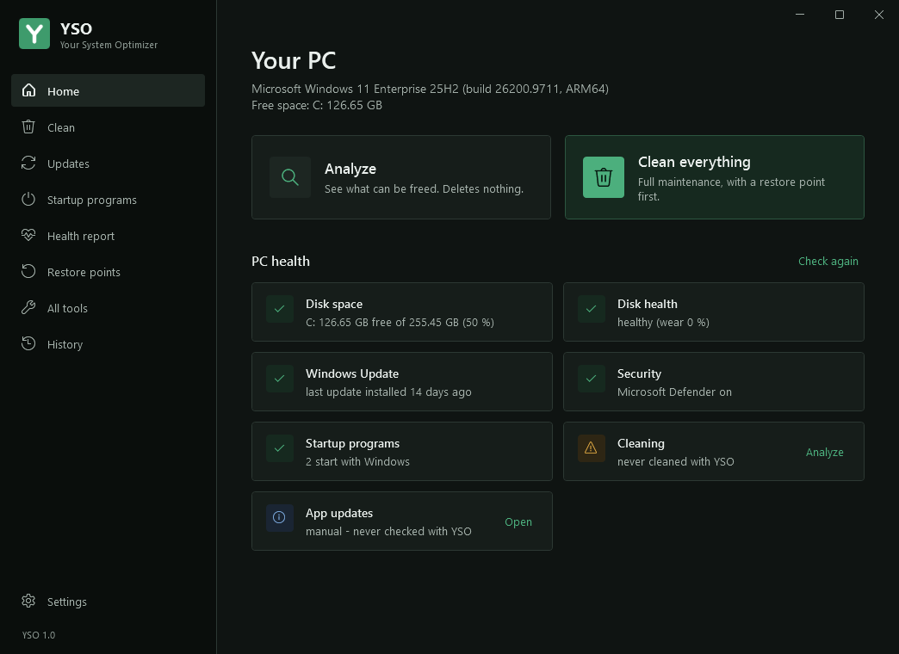
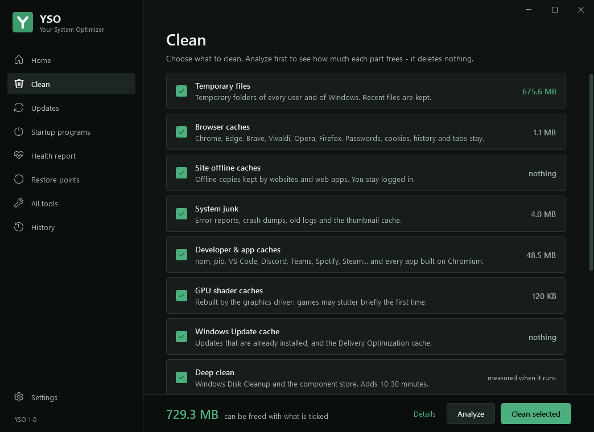
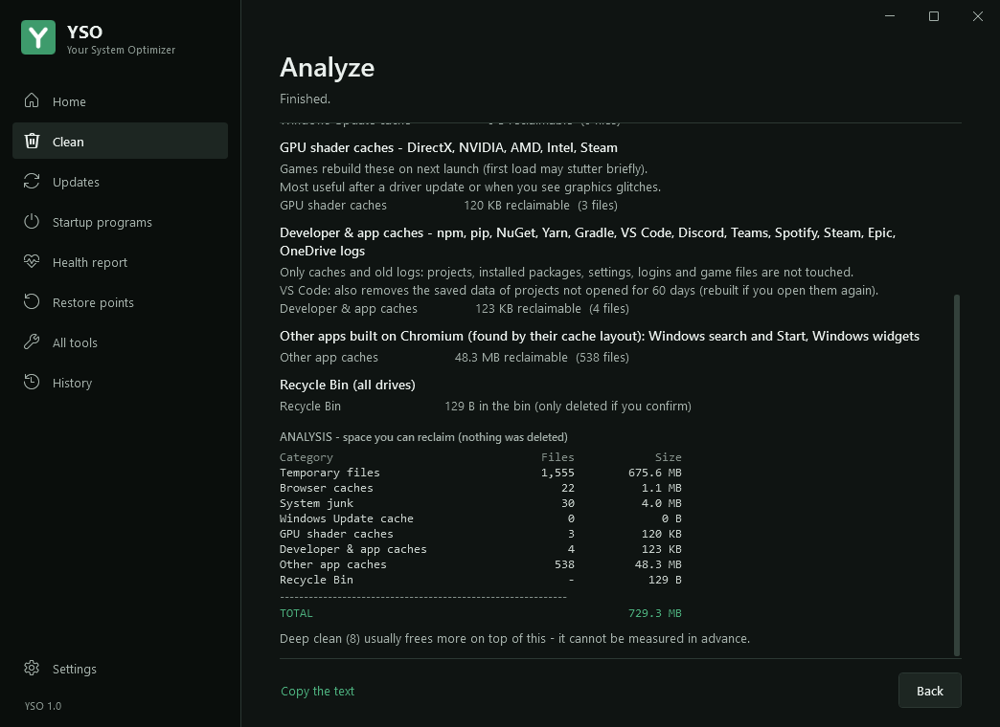
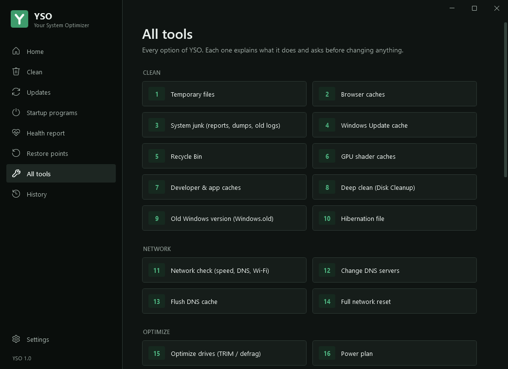

# YSO - Your System Optimizer

[](https://github.com/b-draoui/yso/actions/workflows/tests.yml)

A free, open-source Windows cleaner, health check and maintenance tool. One PowerShell script with its own window: no ads, no account, no telemetry.

**[Version française plus bas](#français)**



## Install

Right-click the Start button > **Terminal** (or Windows PowerShell), paste this line and press Enter:

```powershell
irm https://raw.githubusercontent.com/b-draoui/yso/main/install.ps1 | iex
```

From the Command Prompt (cmd), use this line instead:

```bat
powershell -NoProfile -ExecutionPolicy Bypass -Command "irm https://raw.githubusercontent.com/b-draoui/yso/main/install.ps1 | iex"
```

Windows asks for administrator rights, then YSO opens. It is installed in `C:\Program Files\YSO`, with a shortcut in the Start menu and on the Desktop. [install.ps1](install.ps1) is short: it downloads the latest release from GitHub, checks it against its SHA-256 file, and installs it. Because PowerShell downloads it, Windows does not show "Windows protected your PC".

To uninstall: Settings > Apps > Installed apps > YSO > Uninstall. YSO asks whether to keep its history and settings.

## What it does

| | |
|---|---|
| **Home** | The health of the PC in green, orange or red: disk space and wear, battery, Windows Update, antivirus, startup programs, last cleanup, app updates. Each card has the button that helps. |
| **Analyze** | Measures what can be freed, part by part. Deletes nothing. |
| **Clean** | Temporary files, browser caches (every profile of Chrome, Edge, Brave, Vivaldi, Opera, Firefox), offline copies kept by websites, system junk, developer and app caches (including any app built on Chromium), GPU shader caches, Windows Update cache, Windows Disk Cleanup and the component store. Old driver versions and the Recycle Bin only if you tick them. |
| **Updates** | App updates with winget and driver updates with Windows Update, in one list: manual, "notify me", or automatic on a schedule. |
| **Startup programs** | Switched on and off the same way as Task Manager, with publisher and boot impact. |
| **Health report** | Disk wear, battery capacity, Windows Update status, crashes, security, drivers. |
| **Restore points** | See them, create one, keep only the newest. |
| **All tools** | 28 tools, including network check, DNS, boot time, disk check, memory test, Windows repair (DISM and SFC), space finder, weekly auto-clean, self-test. |



Every tool shows what it does while it works, asks its questions with buttons, and can be stopped. You can copy its full text.





## Safety

- **Analyze before you clean.** It deletes nothing.
- **Never touched:** passwords, cookies, history, bookmarks, site data, messages, Downloads, Documents, extensions, game files.
- **Asked separately** for anything that cannot be undone: Recycle Bin, old driver versions, Windows.old, old restore points, network reset.
- **A restore point** before the full maintenance and before drivers are updated.
- Files in use are skipped, recent temporary files are kept, folder links are never followed, system folders are refused, and you can list folders YSO must never touch.
- Every session is written to `C:\ProgramData\YSO\Logs`.
- Not included on purpose: registry cleaners, "RAM boosters", turning off services in bulk, removing Windows components.

## New versions

When a new version is published, an **Update** button appears in YSO. It downloads the new version from GitHub over HTTPS, checks its SHA-256 checksum and makes sure PowerShell can read it before replacing YSO. YSO asks GitHub at most once an hour, when its window opens; you can turn this off in Settings. See [SECURITY.md](SECURITY.md).

## Requirements

- Windows 10 version 1607 or later, or Windows 11 (Intel, AMD or ARM). Windows PowerShell 5.1, included in those versions.
- Administrator rights (one Windows prompt).
- For app updates: winget (App Installer), included in recent versions of Windows 10 and in Windows 11.

On PCs managed by a school or company, scripts may be blocked: YSO then says why and changes nothing.

## Something went wrong?

In YSO, **All tools > Report a problem** creates a zip on your Desktop with the self-test, the error log and recent logs. User names, the PC name, private IP addresses and the Wi-Fi name are removed first. Nothing is sent: attach it to a [GitHub issue](https://github.com/b-draoui/yso/issues) if you want help. Security problems: see [SECURITY.md](SECURITY.md).

## Privacy and terms

YSO collects nothing. The only connections it makes are listed in the [privacy policy](PRIVACY.md). Use of YSO is covered by the [terms of use](TERMS.md) and the [MIT License](LICENSE).

## Development

- [`YSO.ps1`](YSO.ps1) is the whole program; [`install.ps1`](install.ps1) installs it; `YSO.bat` starts it from a downloaded folder without installing it.
- `pwsh ./tests/run-all.ps1` runs the automated tests (about 600 checks, on Linux or Windows). On every push, GitHub also runs YSO on Windows Server 2022, Windows Server 2025 and Windows 11: self-test, update check, every page of the window in English and French, installation and uninstallation.
- To publish a version: change `$script:Version` in `YSO.ps1`, add its section to [CHANGELOG.md](CHANGELOG.md), and push to `main`. When every test has passed, the release is published with its SHA-256 file, and installed copies of YSO show their Update button.

---

## Français

Un outil gratuit et open source pour nettoyer, surveiller et entretenir Windows : un seul script PowerShell avec sa propre fenêtre. Pas de publicité, pas de compte, pas de télémétrie.

**Installer** : clic droit sur Démarrer > **Terminal**, collez cette ligne puis Entrée :

```powershell
irm https://raw.githubusercontent.com/b-draoui/yso/main/install.ps1 | iex
```

Depuis l'Invite de commandes (cmd) : `powershell -NoProfile -ExecutionPolicy Bypass -Command "irm https://raw.githubusercontent.com/b-draoui/yso/main/install.ps1 | iex"`

Windows demande les droits administrateur, puis YSO s'ouvre. Il est ensuite dans le menu Démarrer et sur le Bureau. Passez en français dans **Paramètres > Language / Langue**. Pour le désinstaller : Paramètres > Applications > Applications installées > YSO.

**Ce qu'il fait** : l'état du PC en vert, orange ou rouge ; **Analyse** (ne supprime rien) ; **Nettoyer**, partie par partie, avec la place libérée par chacune ; mises à jour des applis et des pilotes ; programmes au démarrage ; rapport de santé ; points de restauration ; 28 outils en tout.

**Sécurité** : mots de passe, cookies, historique, favoris, données de sites, Téléchargements et Documents ne sont jamais touchés. Ce qui est irréversible (Corbeille, anciens pilotes, Windows.old) est demandé à part, et un point de restauration est créé avant l'entretien complet.

**Nouvelles versions** : un bouton **Mettre à jour** apparaît quand une version est publiée. Elle est vérifiée (somme SHA-256) avant de remplacer YSO.

**Confidentialité et conditions** : voir la [politique de confidentialité](PRIVACY.md), les [conditions d'utilisation](TERMS.md) et la [licence MIT](LICENSE).
